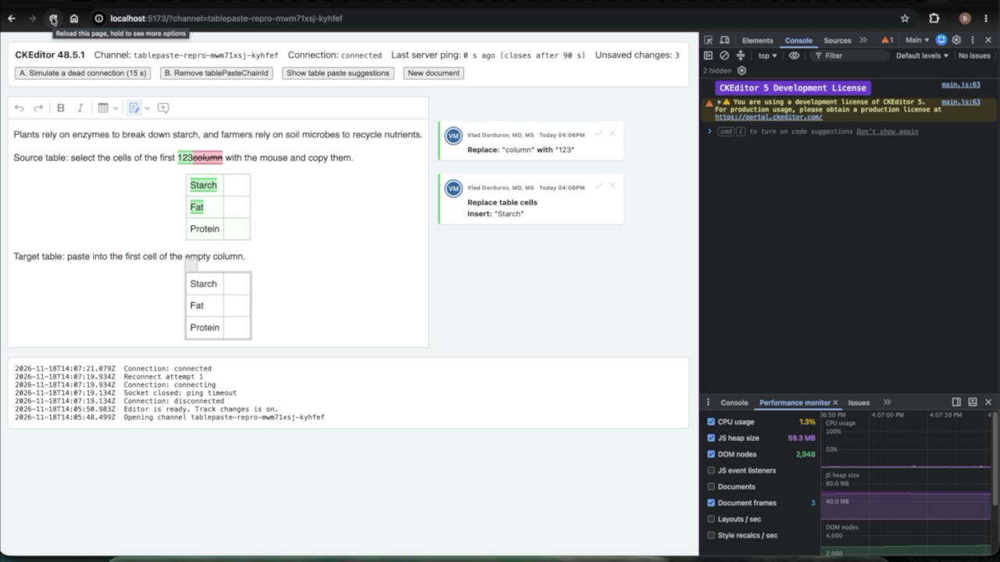

# Table paste suggestion repro (CKEditor 5)

A minimal page that uses only standard CKEditor 5 plugins: `ckeditor5` and `ckeditor5-premium-features` 48.5.1,
which bring Cloud Services SDK 54.2.10. It reproduces two problems:

1. **A re-sent save loses its attributes.** If a suggestion save fails during a reconnect, real-time collaboration
   sends it again after the reconnect, but without `attributes`. Cloud Services then stores `attributes: null`.
2. **A table paste suggestion without `tablePasteChainId` hangs the editor on load.** CKEditor treats every
   suggestion without that attribute as part of the same paste and chains them all. With a word replacement above
   the table, `Suggestion.head` then loops forever.

## Recording

In the [recording](media/table-paste-hang.mp4), a word is replaced, and a column of cells is pasted into the table
while the phone hotspot has no internet. Mobile data is turned back on soon after, but the old connection stays
dead. When **Last server ping** reaches 90 s, socket.io closes it with `ping timeout`, and the editor reconnects.
After a reload, the tab hangs at 100% CPU (see the Performance monitor on the right).

The recording was made with `cloudServices.connectionTimeout` and `requestTimeout` set much higher than the
defaults. The page now uses the defaults.

## What the page contains

- The editor uses standard plugins only: Essentials, Paragraph, Bold, Italic, Table, TableToolbar, CloudServices,
  Comments, TrackChanges, RealTimeCollaborativeEditing, RealTimeCollaborativeComments and
  RealTimeCollaborativeTrackChanges. Every option is a standard one.
- The status line shows the connection state, the time since the last server ping, and the number of pending saves.
  The log below the editor shows connection changes.
- The buttons above the editor are a test harness and do not change the editor:
  - **B. Remove tablePasteChainId** calls the public `suggestion.removeAttribute()`, which also saves the
    attributes to Cloud Services. It checks the hang without a network drop.
  - **Show table paste suggestions** writes the in-memory suggestions to the log.
  - **A. Simulate a dead connection** drops all data on the open WebSocket for 15 s, then closes it. It is not used
    in the steps below.

## Setup

1. Run `npm install`.
2. Copy `.env.example` to `.env` and fill in:
   - `VITE_CK_LICENSE_KEY`: a license key with real-time collaboration and track changes.
   - `VITE_CK_WEBSOCKET_URL`: the WebSocket URL of your Cloud Services environment.
   - `VITE_CK_TOKEN`: a token for that environment that allows writing to every channel (`"*"`), because the page
     creates a new channel for each document. The token is used as is, without refreshing.
3. Run `npm run dev`, then open http://localhost:5173.

Each visit without `?channel=` creates a new document, and the channel id is added to the URL. A reload opens the
same document. **New document** starts a clean one.

## Steps to reproduce (both problems)

Connect the computer to the internet through a phone hotspot. When the phone's mobile data is turned off, the
computer stays on Wi-Fi, so the browser does not notice the drop and the editor stays editable: the connection is
half-open.

1. Open a new document. Wait for **Connection** `connected`. Track changes is on (the page turns it on).
2. In the paragraph just above a table, select a word and type another one. This creates a word replacement. Wait
   for **Unsaved changes** `0`.
3. Select a column of cells in the other table with the mouse and copy it.
4. Turn off mobile data on the phone.
5. Paste the cells into the first column of the table below the replaced word. **Unsaved changes** goes up.
6. Turn mobile data back on. This can be done right away.
7. Wait until the editor notices the dead connection and reconnects: the log shows `Socket closed: ping timeout`
   (when **Last server ping** passes the "closes after" value), `Connection: disconnected`, and then
   `Connection: connected`.
8. Optional: read the suggestions through the REST API:
   `GET /api/v5/<environment id>/suggestions?document_id=<channel id>`.
9. Do not accept or reject the suggestions. Reload the page.

**Expected:** the document loads, and the suggestions keep their attributes.

**Actual:**
- In step 8, the table paste suggestions saved during the outage have `attributes: null`.
- In step 9, the tab hangs at 100% CPU while the document loads.

Notes:
- The old connection has to die. Turning mobile data off and on usually gives the phone a new address, so the old
  connection never recovers, and the client notices that only from the heartbeat. If the connection survives
  instead, TCP delivers the stuck data late, the save keeps its attributes, and nothing goes wrong. In that case the
  log shows no `Connection: disconnected`. Start a new document and try again.
- Steps 2 and 5 have to be done in the same session. If the page is reloaded between them, the document loads.

## The hang only

1. Do steps 1–3 above, without turning off mobile data.
2. Paste the cells into the first column of the table below the replaced word.
3. Click **B. Remove tablePasteChainId**, wait a few seconds, then reload.

**Actual:** the tab hangs at 100% CPU on load.

## After a hang

Close the tab. The document stays broken, and opening it will hang again. Start the next attempt with
**New document**.
